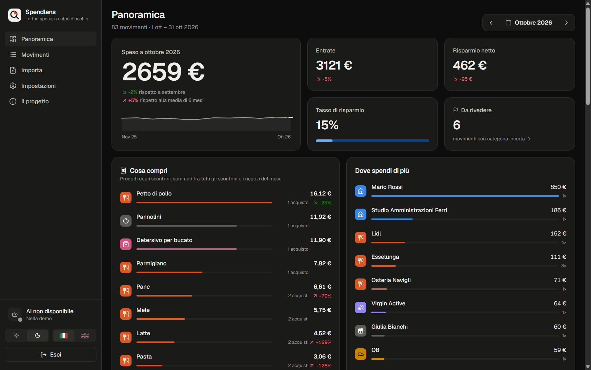
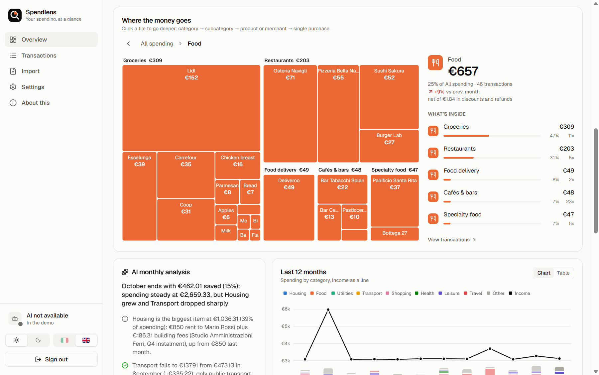
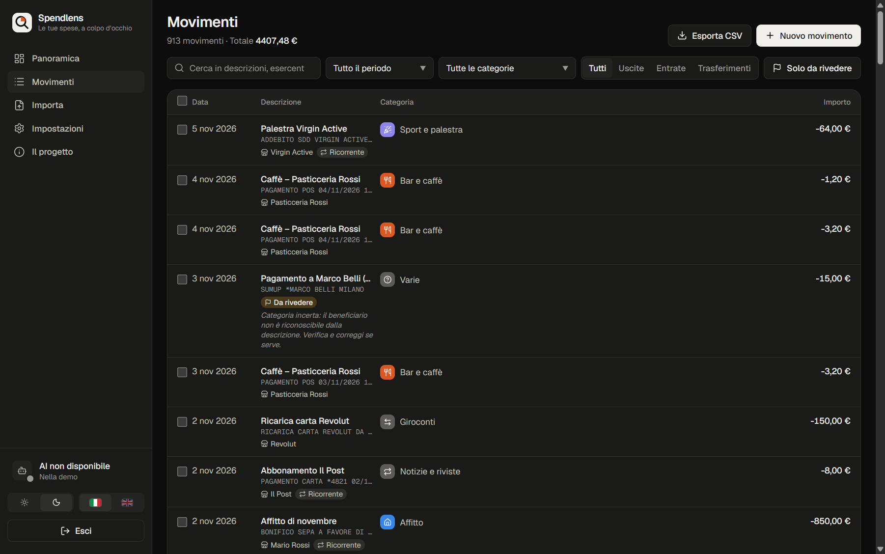
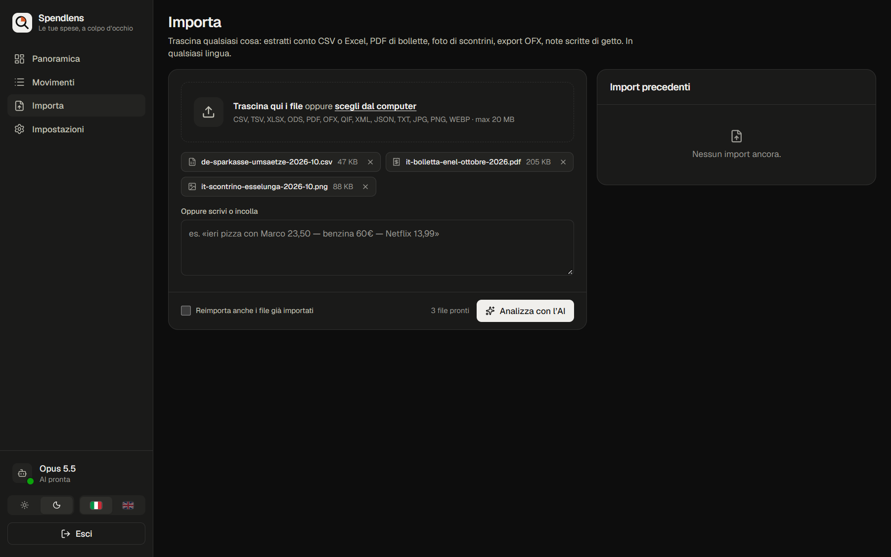
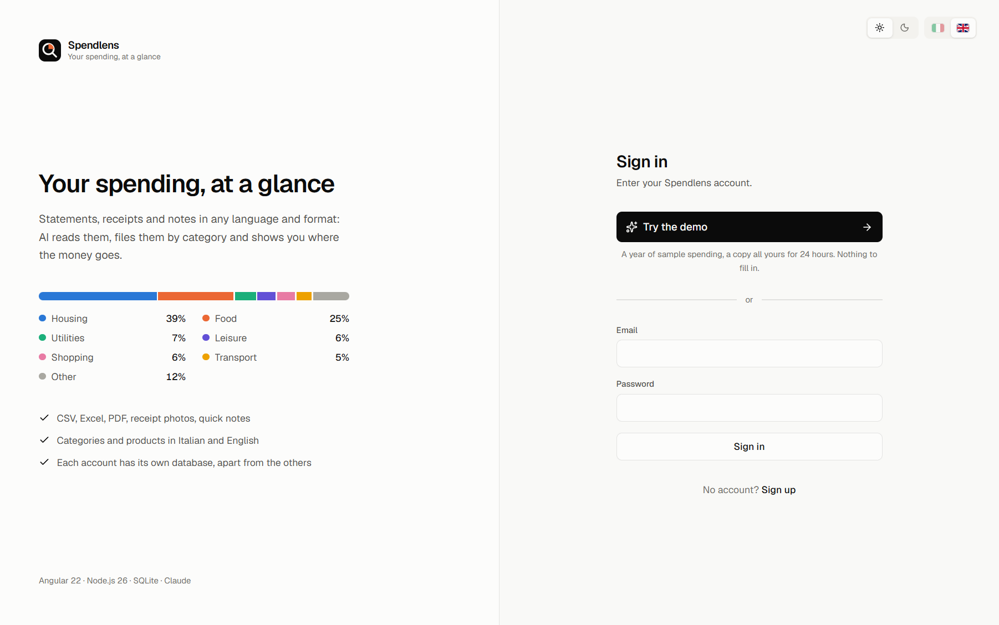
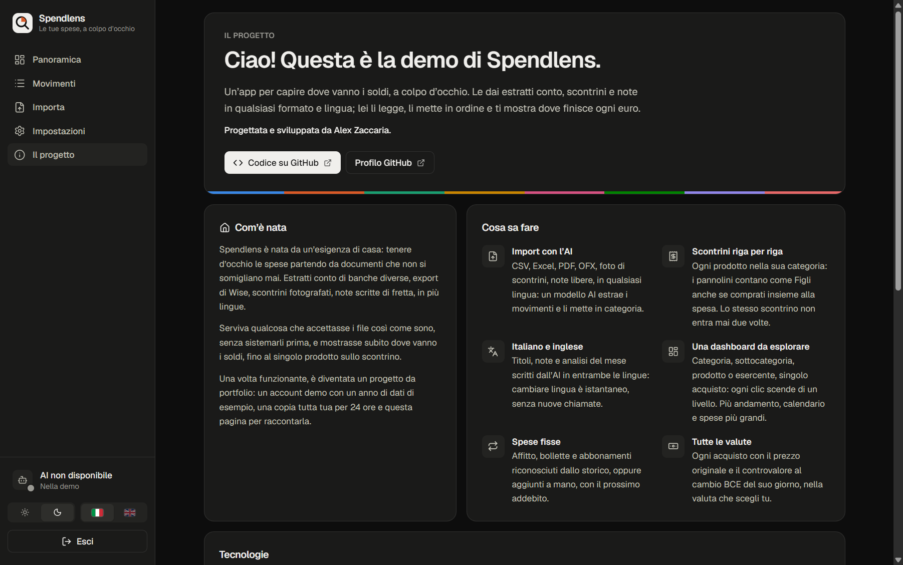

# Spendlens

**Your monthly spending, at a glance — from any statement, receipt or note, in any language.**

**[Live demo → spendlensdemo.netlify.app](https://spendlensdemo.netlify.app)** · one click, no sign-up: a year of
sample data that runs entirely in your browser.

Drop a German bank CSV, a French OFX card export, a Spanish Excel sheet, an Italian utility bill
PDF, a photo of a London receipt or a few lines typed in a hurry: an AI model reads them, files
every transaction under a two-level category, writes a clean title in **Italian and English**, and
converts foreign currencies at the ECB rate of the day. The dashboard then shows where the money
goes — rent, bills, food and *which* food — without a single manual mapping.

Sign in to your own account, or try the demo in one click: every visitor gets a private copy of
a year of sample data for 24 hours. Each account is its own SQLite file run by Node.js; there is
no cloud database. The [online demo](https://spendlensdemo.netlify.app) needs no server at all: it is a static
site where the same API runs inside the browser, on SQLite compiled to WebAssembly
([Static demo](#static-demo-on-netlify)).

| Overview (dark, Italian) | Drill-down: Food → products and merchants (light, English) |
|---|---|
|  |  |
| **Transactions** | **Import** |
|  |  |
| **Sign in, or try the demo in one click** | **About this (demo account)** |
|  |  |

## Highlights

- **AI-first ingestion of irregular input.** CSV/TSV in any delimiter and encoding (UTF-8, UTF-16,
  Windows-1252), XLSX/XLS/ODS, OFX/QIF, CAMT XML, JSON, HTML, PDF (read natively by Claude and
  OpenAI, as text elsewhere), receipt photos, free-form notes with relative dates ("ieri",
  "yesterday", "gestern"). Long statements are split into parts that keep their header row.
- **Bilingual by construction.** Every text the model writes — titles, notes, import summaries,
  warnings, the monthly analysis — comes back as `{ it, en }`. Switching language is instant and
  costs no extra call.
- **At-a-glance dashboard you can drill into.** Hero figure with month-to-date comparison and a
  spending explorer where every click goes one level deeper — category → subcategory → product or
  merchant → the single purchase (opened in the editor) — with an inspector panel listing the same
  node's breakdown for keyboard and screen-reader users. Plus a 12-month stacked trend with
  income, fixed costs, top merchants, a day-by-day heatmap, the largest expenses and an AI digest
  of the month.
- **Fixed costs, detected and declared.** Rent, bills and subscriptions are found from three or
  more charges at a steady cadence and amount. A cost can also be declared by hand (amount,
  category, cadence, next charge) and counts from day one, before any payment; a detected one can
  be made your own with your values, or ruled out as "not a fixed cost" (undoable, and listed in
  Settings → Rules). Declared costs flag their payments as recurring once they arrive. A payment
  entered by hand can be declared on the spot ("Fixed cost: repeats every month"), and the next
  charge never falls before the first one given nor on a day already paid.
- **Multi-vendor AI seam** (same design as Solexma's): Anthropic with an API key *or* the Claude
  Code `credentials.json` (re-read on every call, refreshed when about to expire), OpenAI
  (Responses API) and any OpenAI-compatible server (Ollama, LM Studio, vLLM, OpenRouter, gateways).
  Structured output against a JSON Schema on every provider; secrets are write-only.
- **Learns from corrections.** Fix a category and tick "use for every X": the history is
  re-filed and a merchant rule steers future imports.
- **Receipts itemised line by line.** A supermarket ticket becomes its products, each in its own
  category: nappies count as Kids and detergent as Household even when bought with the groceries.
  A discount on the total is shared pro rata, so the lines keep their printed prices and still add
  up to the amount paid. **What you buy**, right below the headline figures, adds every product up
  across receipts and shops — ten 1,000 € packs of nappies on ten receipts are one 10,000 € row at
  the top — and the explorer groups receipt lines by product the same way. The model is given the
  product names already in use, so the same product keeps the same name.
- **Accounts with data kept apart by construction.** One SQLite file per account, so no query can
  mix two accounts' data: there is no account column to forget in a WHERE clause. Passwords are
  hashed with argon2id from `node:crypto`; the session is an HttpOnly, SameSite=Strict cookie
  whose SHA-256 is all the server stores. Sign-up is closed: accounts are created from the
  command line.
- **One-click demo.** *Try the demo* copies the demo account into a private sandbox
  (`VACUUM INTO`) that expires after a day; leaving the demo deletes it at once. AI is off in the
  demo, which shows a monthly analysis written in advance.
- **A static demo running the real API.** For hosting without a server, the API's routes and
  repositories are bundled for the browser and run on SQLite compiled to WebAssembly; the page
  sends its `/api` requests there instead of the network. A test checks that it answers byte for
  byte like the Node server on the same data.
- **Deduplication that survives re-extraction.** Overlapping statements are de-duplicated even
  though the model rewrites lines differently each run; a receipt that matches a card payment is
  flagged for review instead of being counted twice. A receipt is identified by what it prints —
  its document number and time, read by the model — so the same receipt photographed twice, or
  photographed and then scanned, is stored once (a unique index refuses the second copy), while
  two coffees at the same bar, same price, same day stay two.
- **Wise-aware.** Multi-balance Wise exports: conversions between your own balances are transfers,
  fees already included in the amount are never added twice.
- **Every currency, shown both ways.** A purchase keeps the amount it was charged in and gets its
  value in your currency at the ECB rate of its day; receipt lines follow their receipt. Wherever a
  single purchase or line appears — the list, the editor, the explorer, the largest expenses, a
  fixed cost billed in dollars — both amounts are shown, and so does every total whose purchases
  were all charged in one foreign currency: the month, income and savings, a merchant, a product,
  an explorer node, a filtered list. Totals mixing currencies, and the charts, are in yours.
  Pick that currency in Settings → Data (any of the 30 with an ECB rate) and the whole history is
  converted again, day by day. The model reads a receipt's currency from its symbol and the
  shop's country ("$" in Canada is CAD), and amounts left without a rate while offline are
  converted after the next import.
- **Accessible, themeable charts.** CVD-validated categorical palette with a fixed colour per
  category (never per rank), sequential ramp for magnitude, dedicated dark-mode steps, table
  views and meaningful labels for screen readers.

## How an import works

```
POST /api/imports  (multipart: files[] + pasted text, answered as Server-Sent Events)
  └─ for each file
       ├─ decode           magic bytes → text / spreadsheet / PDF / image; encoding detection
       ├─ plan calls       native PDF or image when the provider reads them, else text parts
       │    └─ chunk       ~12k characters per part, preamble + header row repeated
       ├─ extract          provider.complete(system prompt + taxonomy, JSON Schema)  × parts
       │    └─ answer      document info + transactions + warnings, all texts in it and en;
       │                   a receipt's document number and time, its currency from symbol + country
       ├─ normalise        signed minor units, ISO dates, merchant rules, sign/category checks
       │    └─ items       receipt lines with their own categories, discounts shared pro rata
       ├─ convert          ECB rate of each transaction's day (Frankfurter), cached in SQLite
       ├─ store            fingerprint and printed-reference dedup (unique indexes),
       │                   certain-duplicate drop, probable-duplicate review
       └─ event            file-done with the bilingual summary, tokens and model
  ├─ backfill             amounts an earlier import left without a rate (offline) are converted
  └─ refresh recurring    cadence + amount analysis, plus the fixed costs declared by hand
```

## Stack

| Layer | Choice |
|---|---|
| Web | Angular 22 (zoneless, signals, `httpResource`, Signal Forms, `@Service`), Angular Aria, Tailwind CSS 4, ECharts 6 (lazy, SVG renderer), Lucide icons, Geist |
| API | Node.js 26 running TypeScript natively (type stripping, no build step), Hono 4, Zod 4 |
| Storage | `node:sqlite` (built into Node) with WAL, STRICT tables, FTS5 search across both languages; one database per account |
| AI | `@anthropic-ai/sdk`, `openai` — only inside `apps/api/src/ai/providers/` |
| Static demo | `@sqlite.org/sqlite-wasm` in place of `node:sqlite`, esbuild, IndexedDB, Netlify |
| Tooling | npm workspaces, TypeScript 6, Vitest (web), `node:test` (API and contracts) |

## Getting started

Requirements: **Node.js 26** (Angular 22 needs ≥ 22.22.3 / 24.15 / 26) and **npm**: the
workspaces and the lockfile are npm's, and pnpm refuses the project (`packageManager`).

```sh
npm install
npm run account -- create you@example.com --name "Your name"   # asks for the password
npm run dev       # API on :4300, web on :4200 (proxied /api)
```

The first start creates the demo account with 13 months of generated data. Open
http://localhost:4200, sign in, then **Settings → AI provider**:

- **Anthropic** — paste an API key, or pick one of the Claude Code `credentials.json` files the
  app finds on this computer (`~/.claude*`, `$CLAUDE_CONFIG_DIR`, `ant` profiles), or upload one.
  Files you don't use can be removed from the list (the file itself is left alone). The model
  picker offers the newest model of each line, read from the Models API, and the reasoning effort
  levels that model supports.
- **OpenAI** — an API key; once saved, the model list loads by itself.
- **OpenAI-compatible** — the server URL (e.g. `http://localhost:11434/v1` for Ollama) and a model.

Every change is saved as you make it. The dot in the sidebar turns green once the provider has
answered with the saved settings (its model list, which costs no tokens) and red with the
provider's error when it refuses them. Then drop the files in `samples/` on the Import page.

Production build, one process serving both API and web app on :4300:

```sh
npm start
```

Environment variables are optional; see `.env.example`.

Accounts, from the command line (sign-up is closed in the app):

```sh
npm run account -- list
npm run account -- create <email> [--name "Name"]
npm run account -- password <email>          # also signs every other session out
npm run account -- rename <email> [--email <new>] [--name "New name"]
npm run account -- delete <email> --yes
```

An install from before accounts existed (`data/spendlens.db`) is moved over on the first start:
its data becomes the demo, its AI settings go to a new empty owner account
(`me@spendlens.local`, or `SPENDLENS_OWNER_EMAIL`), and the old file is kept as
`spendlens.pre-accounts.db`.

## Static demo on Netlify

The public demo, [spendlensdemo.netlify.app](https://spendlensdemo.netlify.app), is a static site with no server
and no functions. The API itself runs inside the page: the same Hono routes, repositories and
migrations as on Node, bundled for the browser, with SQLite compiled to WebAssembly in place of
`node:sqlite`. The web app's static build sends its `/api` requests to it instead of the network,
so the app code is unchanged.

```
npm run build:static                     what Netlify runs (netlify.toml)
  ├─ build:browser                       apps/api/src/scripts/build-browser.ts → apps/web/.local-api/
  │    ├─ spendlens-api.js               apps/api/src/browser/entry.ts bundled by esbuild
  │    │    ├─ node:sqlite → sqlite.ts   DatabaseSync on @sqlite.org/sqlite-wasm, same calls as Node's
  │    │    ├─ node:crypto → crypto.ts   SHA-256 (@noble/hashes) and random UUIDs
  │    │    └─ fs, AI SDKs, PDF/Excel → server-only.ts, stand-ins that throw (the demo has no AI)
  │    ├─ sqlite3.wasm
  │    └─ spendlens-demo.db.gz           the demo snapshot, committed (apps/api/demo/)
  └─ ng build -c production,static
       ├─ core/backend.ts → backend.static.ts   loads the bundle, routes /api/* fetches to it
       └─ .local-api/ → /local-api/      served next to the app
```

What a visitor gets:

```
Opening the site
  ├─ the browser API starts              about 0.6 MB compressed: bundle and WebAssembly
  ├─ the sign-in page                    the form is disabled: this version only has the demo
  ├─ Try the demo                        the snapshot (450 kB) becomes a private copy in IndexedDB
  ├─ every /api request                  answered in the page; what it changes is saved before the answer
  ├─ coming back within 24 hours         the same copy, with the visitor's changes
  └─ Sign out                            the copy is deleted
```

The snapshot is the demo account at the moment it was taken, including the receipt import and the
monthly analyses written by the AI. Those analyses quote the figures of their month, so the static
demo runs on the day of the snapshot: `setToday()` in `@spendlens/contracts` moves the clock of
both the page and the browser API, and the current month, fixed costs and analyses stay consistent
however long after it is visited. Only the ECB exchange rates (Frankfurter, which allows calls from
browsers) come from the network, when a visitor changes the base currency.

Locally:

```sh
npm run build:static     # dist in apps/web/dist/web/browser, servable by any static server
npm run start:static     # the same on the Angular dev server, http://localhost:4200
npm run demo:snapshot    # takes a new snapshot of the local demo account; commit the .gz
```

To move the demo forward, regenerate the demo account (`npm run seed -- --insight` writes its
analyses with the owner's AI), take a new snapshot and commit it. Visitors with a copy of the
previous snapshot start again from the new one.

Publishing with Netlify's Git integration, once:

1. Push the repository to GitHub.
2. In Netlify, *Add new project → Import an existing project → GitHub*, and pick the repository.
3. Leave the build settings as they are: `netlify.toml` gives the build command
   (`npm run build:static`), the publish directory (`apps/web/dist/web/browser`), Node 26, the
   fallback of client-side routes to `index.html` and the `application/wasm` type. Deploy.

From then on every push to the production branch (`main`) rebuilds and publishes the site, a pull
request gets its own deploy preview, and a build that fails leaves the published version online. A
push that only touches what the site is not built from (README, docs, samples) is skipped: the
`ignore` command in `netlify.toml` finds no change under `apps/`, `packages/` and the build files.
The site name (here `spendlensdemo`) and a custom domain are set in the project's configuration on Netlify.

The LICENSE does not allow publishing the app: these steps are for the author's demo, and any
other public deployment needs written permission.

## Project structure

```
spendlens/
  ├─ apps/
  │    ├─ api/                     Hono API on Node 26 (TypeScript run natively)
  │    │    ├─ demo/               the static demo's snapshot (spendlens-demo.db.gz)
  │    │    └─ src/
  │    │         ├─ api.ts         the routes of one account, mounted by the server and by the browser build
  │    │         ├─ accounts/      accounts, sessions, argon2id, one database per account, demo sandboxes
  │    │         ├─ ai/            provider seam, settings, OAuth credentials, insights
  │    │         │    └─ providers/  anthropic · openai · openai-compatible (only SDK imports)
  │    │         ├─ browser/       the API in the browser: sqlite-wasm shim, IndexedDB copy, stand-ins
  │    │         ├─ ingest/        decode, chunk, prompt, extraction schema, pipeline
  │    │         ├─ repo/          transactions, analytics, recurring, rules, imports
  │    │         ├─ db/            node:sqlite, migrations, row mappers
  │    │         ├─ demo/          deterministic demo-data generator, snapshot location
  │    │         ├─ routes/        HTTP routes (SSE for imports), auth
  │    │         └─ scripts/       seed, account (CLI), demo snapshot, browser build
  │    └─ web/                     Angular 22 app
  │         └─ src/app/
  │              ├─ core/          auth, backend (server or in-page API), i18n (it/en), API client, import stream, theme
  │              ├─ layout/        the signed-in shell (sidebar, AI status, sign-out)
  │              ├─ ui/            icon, flag, preferences, category picker, delta, sparkline, chart
  │              └─ features/      auth · dashboard · transactions · import · settings · about
  ├─ packages/
  │    └─ contracts/               taxonomy, types (browser-safe) and Zod schemas (API)
  ├─ samples/                      10 irregular multilingual input files + README
  ├─ tools/make-samples.ts         regenerates samples/ byte for byte
  ├─ netlify.toml                  build and routing of the static demo
  └─ LICENSE                       noncommercial, no redistribution
```

## Scripts

| Command | What it does |
|---|---|
| `npm run dev` | API with `node --watch` + Angular dev server |
| `npm run account -- …` | Create, rename, delete accounts and set passwords |
| `npm run seed` | Regenerate the demo account's data (`-- --insight` also writes its monthly analyses with the owner's AI) |
| `npm run demo:snapshot` | Copy the demo account into the static demo's snapshot (`apps/api/demo/`) |
| `npm run build:static` | Build the static demo: the API for the browser, then the web app (what Netlify runs) |
| `npm run start:static` | The static demo on the Angular dev server |
| `npm run samples` | Regenerate the sample input files |
| `npm run typecheck` | Type-check contracts, API and web |
| `npm test` | `node:test` suites (contracts, API) and Vitest (web) |
| `npm start` | Build the web app and serve everything from the API |

## Privacy

- Each account's transactions, imported files, rules and settings stay in its own file,
  `apps/api/data/accounts/<id>.db`; `apps/api/data/system.db` holds the accounts and sessions.
- A file you import is sent to the AI provider you configured, and nowhere else. The monthly
  analysis sends the month's aggregates: category and merchant totals, recurring charges and the
  titles of the three largest expenses — not the transaction list.
- API keys and imported credentials are stored locally and never returned to the browser; a
  credentials file *path* is re-read on each call, so the token Claude Code refreshes is used.
- Exchange rates come from the public ECB reference rates (Frankfurter); only currency codes and
  dates are sent.
- In the static demo nothing is sent anywhere: the visitor's copy lives in their browser
  (IndexedDB), deleted on sign-out or at the first visit after a day; only the exchange-rate
  lookups go out.

## About the project

Spendlens started from a household need — keeping an eye on spending from statements, receipts and
notes that never look alike — and grew into a portfolio project by Alex Zaccaria. The demo account
has an *About this* page that tells the story and the choices behind it.

## License

Source-available, not open source: see [LICENSE](LICENSE). You may read, run and modify the code for
noncommercial purposes — personal use, study, or evaluating the author's work. Commercial use and
redistribution, modified or not, are not allowed without written permission.
